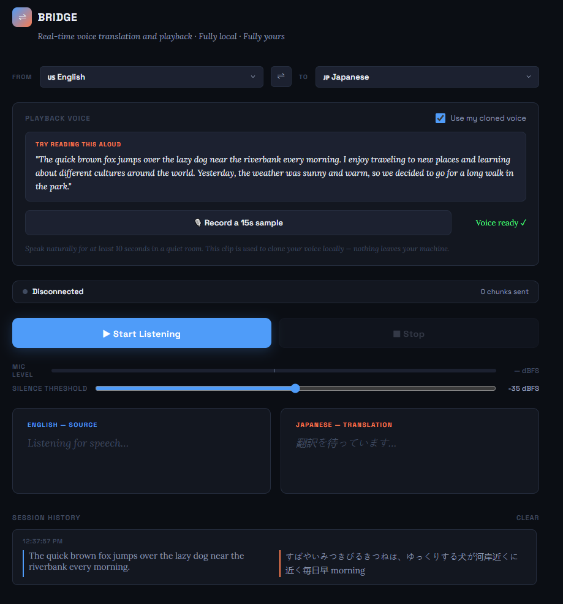

# Bridge: Real-Time Voice Translation

  

  

---

## 🎤 What is Bridge?

**Bridge** is a real-time, bidirectional voice-to-voice translation engine. Speak naturally into your microphone in one language and hear the translation spoken back immediately — either with a natural preset voice or **cloned dynamically in your own voice**.

- 🌐 **Try it Live**: Connect directly from your phone or desktop browser at **[https://tinyurl.com/bridge-app](https://tinyurl.com/bridge-app)**
- 🔒 **100% Private**: Zero cloud API dependencies; all speech recognition, LLM reasoning, and neural voice synthesis run on private dedicated GPU compute.
- 📱 **Universal Access**: Runs seamlessly across iOS Safari, Android Chrome, and modern desktop browsers without installing native apps.

---

## ✨ Features

- 🎙️ **Real-time translation**: Bidirectional speech-to-speech with live side-by-side subtitle streaming.
- 🌍 **11 languages supported**: English, Spanish, French, Italian, Japanese, Chinese, Hindi, Portuguese, German, Korean, and Telugu.
- 🔄 **One-click swap**: Instant switching between source and target languages via the **⇌** button.
- 🗣️ **Personalized voice cloning**: Record a 15-second voice sample and hear the translated speech in *your own voice*.
- 🔇 **Acoustic feedback protection**: Audio is routed safely with automatic speech detection pausing while translation audio plays, preventing echo loops over speakers.
- 📱 **Mobile & desktop ready**: Seamless touch controls, gesture-unlocked Web Audio, and adaptive sample rates across iPhone, iPad, Android, and laptops.

---

## 🌍 Supported Languages

| Language | Speak (STT) | Live Subtitles | Voice Output (TTS) | Voice Cloning |
|---|:---:|:---:|:---:|:---:|
| 🇺🇸 English | ✅ | ✅ | ✅ | ✅ |
| 🇪🇸 Spanish | ✅ | ✅ | ✅ | ✅ |
| 🇫🇷 French | ✅ | ✅ | ✅ | ✅ |
| 🇮🇹 Italian | ✅ | ✅ | ✅ | ✅ |
| 🇯🇵 Japanese | ✅ | ✅ | ✅ | ✅ |
| 🇨🇳 Chinese | ✅ | ✅ | ✅ | ✅ |
| 🇮🇳 Hindi | ✅ | ✅ | ✅ | ✅ |
| 🇧🇷 Portuguese | ✅ | ✅ | ✅ | ✅ |
| 🇩🇪 German | ✅ | ✅ | ✅ | ✅ |
| 🇰🇷 Korean | ✅ | ✅ | ⏳ (Piper weights) | ✅ |
| 🇮🇳 Telugu | ✅ | ✅ | Subtitles only | Subtitles only |

> **Notes on Coverage:**
> - **Voice Cloning**: Powered by Chatterbox Multilingual. Available across all languages above except Telugu. German and Korean are supported natively for voice cloning.
> - **Telugu**: Full speech-to-text recognition and text translation are supported; translation appears in the live subtitles. Neural TTS voice synthesis for Telugu is currently unavailable.
> - **Korean**: Preset voice output requires the optional Piper voice weights; Korean voice cloning is supported natively.

---

## 🧭 How to Use

### 1. Open the Web Application
Navigate to **[https://tinyurl.com/bridge-app](https://tinyurl.com/bridge-app)** in your browser (Safari on iOS, Chrome on Android/Desktop).

### 2. Choose Your Languages
- **From**: The language you will speak.
- **To**: The language you want to hear back.
- Click **⇌** at any time to invert the direction.

### 3. (Optional) Clone Your Voice
To hear translations spoken in your own voice rather than the preset voice:
1. In the **Playback Voice** panel, click **Record a 15s sample**.
2. Read the prompt naturally in a quiet environment. The recording finishes automatically at 15 seconds.
3. Check **Use my cloned voice** (enabled automatically once processed).
4. *Note: Voice samples remain private in server memory for your session only.*

### 4. Start Translating
1. Click **▶ Start Listening** and grant microphone permissions when prompted.
2. The status indicator will switch to **Listening…**.
3. Speak normally. Once you pause at the end of a sentence, Bridge automatically detects the pause and starts processing.
4. The transcription appears on the left, the translated text on the right, and the synthesized audio streams to your speaker or headphones.

### 5. Finish Your Session
When you are done speaking, click **⏹ Stop**.

---

## ⏳ Latency & Real-Time Expectations

Bridge processes your speech through an on-premise neural pipeline:
1. **Speech-to-Text**: Whisper model converts your speech to text.
2. **Translation**: Llama 3.2 3B translates the text into the target language.
3. **Voice Synthesis**: Kokoro / Piper or Chatterbox neural voice synthesis generates audio.

**Cascade latency:** End-to-end processing typically takes **~5–8 seconds** per sentence depending on sentence length and server load. Watch the **Processing…** badge in the interface to monitor active translation.

---

## ❓ Tips for the Best Experience

- **Mic Sensitivity**: If speech is not being picked up, adjust the **Silence threshold** slider slightly to the right (toward -30 dBFS) until ambient room noise sits below the indicator.
- **Natural Pauses**: Speak in complete sentences and pause naturally for ~0.5 seconds to trigger translation.
- **Headphones Recommended**: While Bridge features echo-prevention logic, using headphones ensures optimal speech isolation in noisy environments.
- **Browser Audio Permission**: If you don't hear translated audio, tap or click anywhere on the page once to satisfy your browser's audio autoplay policy, and verify your device volume.

---

## 🛠️ Architecture & Self-Hosting

Bridge is open-source. If you are a developer looking to inspect the full architecture, review CUDA requirements, or deploy your own local GPU server:

👉 **[See technical-setup/DOCUMENTATION.md](technical-setup/DOCUMENTATION.md)** for:
- Complete system architecture diagrams & raw Float32 PCM WebSocket protocol
- Hardware benchmarks & VRAM budgets (RTX 3070 Ti, 8 GB VRAM)
- Single 1-click automated installer (`setup.ps1` / `setup.bat`)
- Automated model asset downloader (`scripts/download_models.py`)
- Remote phone-tunnel and SSH management guides (`technical-setup/REMOTE_ACCESS.md`)
- Dependency troubleshooting & recovery guide (`technical-setup/bridge-troubleshooting-guide.md`)
